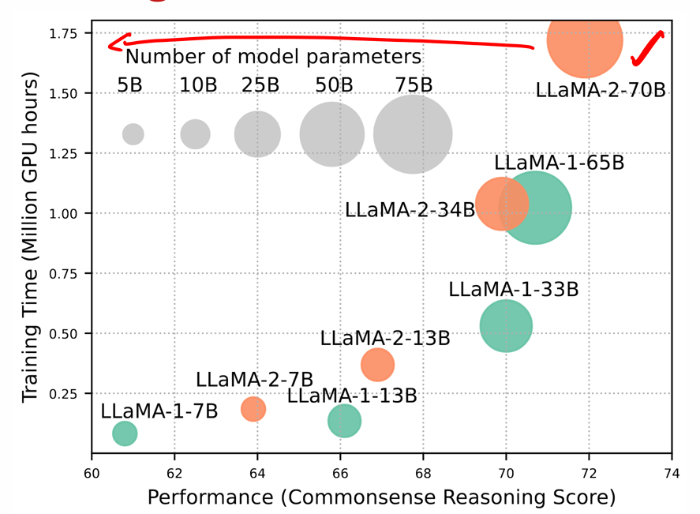
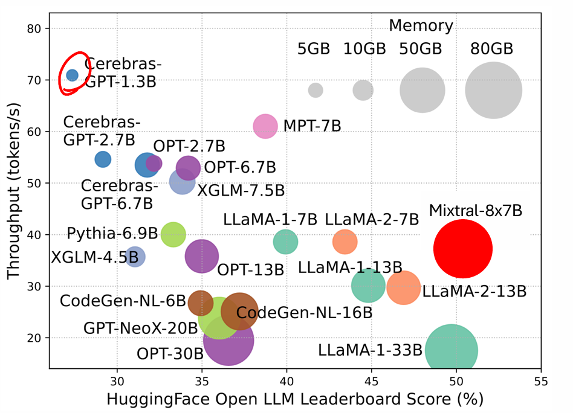
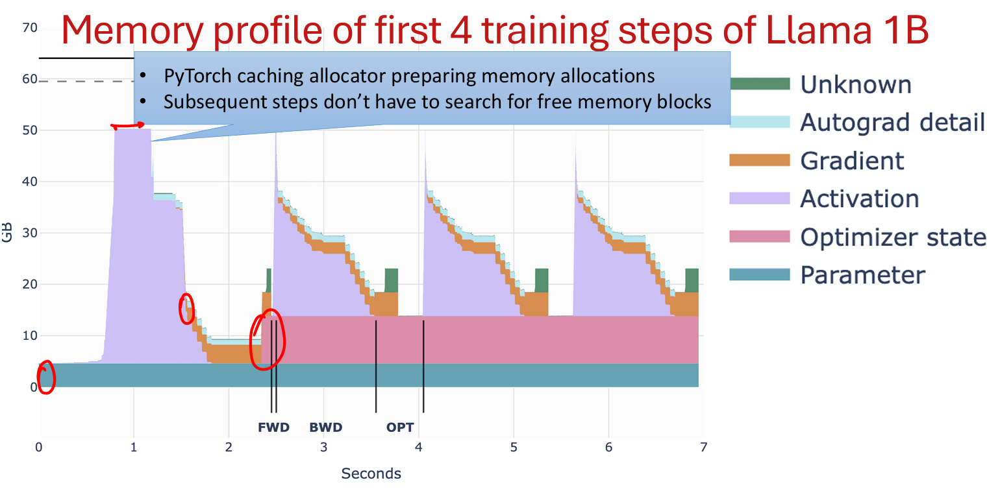
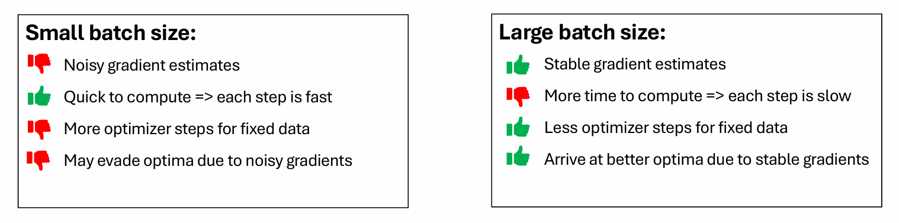
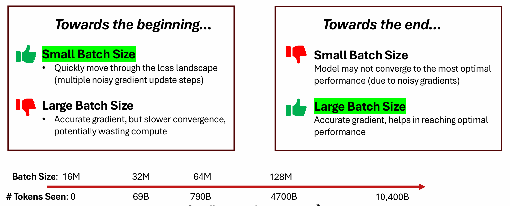
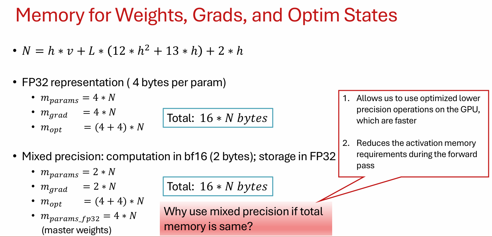

# L11 :

Question-1 : What is the trade off between resources and performance of the model during training ?



Quest-2 : What is the trade off between throughput vs performance of model during inference time ?

Remark : Throughput : How many tokens llms able to generate per second ?



You can see MPT-7B and Llamma1-7B they have approx same size and performance but different throughput.  Why ? Due to efficient implementation.

You can see Mixtral-8x-7B and Llama-1-33B both are approx same size and performance but different throughput. Why ?

### Efficient LLMs - Parallelism

Quest-2 : How to scale the training ?

1. Data Parallelism
2. Tensor Parallelism
3. Context Parallelism
4. Pipeline Parallelism

Same Algorithm with Efficient Implementation

1. Flash Attention - writing efficient kernel for specific operations.
2. Paged Attention -

Same Algorithm with Efficient Design - Similar Performance and Size but different throughput! Why ?

1. Efficient Architecture Design

- Group Query Attention
- Mixture of Expert

### 1. How to train a deep learning(llm) model onto GPU ?

Lets consider the single gpu for the simplicity

1. Model Initialization
2. Data Loading and Preprocessing
3. Training Loop
4. Model Saving and Evaluation

```python
1. Model Initialization
class Model_Name(nn.Module):
    def __init__(self, ....):
        # layer1 
        # activation1
        # layer2
    def forward(self, x):
        # pass the data though each layer of the model
2. Data Loading and Preprocessing
load the dataset from huggingface
preprocess into the batches via dataloader and transforms function from torch

3. Model Training
device = torch.device.is_available( if "cuda:0" else "cpu")
Training loop
for batch in dataloader:
   batch = batch.to(device)
   loss = model(batch)
   loss.backward()
   optim.step()
```

What is present into the GPU memory during model training ?

1. Batch X - x
2. Model Parameters - remain
3. Activations used to - x
4. model gradients(backpropagation) - x
5. optimizer state(2X) -
   They remains into the memory until update by optim.step()

PyTorch caching allocator preparing memory allocations

ubsequent steps don’t have to search for free memory blocks



Quest : What is the typical batch size used for pretraining ?

Memory for one sequence is above 50GB
Number of tokens = Batch Size Tokens bst = bs * seq

Ex- Llama1 - batch size -4M for 1.4T tokens
Ex- DeepSeek - Batch size - 60M for 14T tokens

Quest : What is the trade off between small and larger batch size for model training ?
It affects the models convergence to the optima during training


Quest : What is could be the optimal batch size ?
At a particular loss, level what could be the batch size that provides faster convergence during training.

Starts with small batch size and keep on increasing


### How much memory for Weights, Gradients and Optimizer States

Asumme embedding(hidden)dimention(h), vocabulary(v) and number of layers(L). Then

1. Token Embedding : How many token embeddings are there ? (v*h)
2. Multi-Head Attention(MHA) Q, K and Value : 3(h**2 + h)
3. Projection : (h**2 + h)
4. layer Norm given (x, h): 2*h for sigma and var
5. MLP : (h*4h + 4h) + 4h**2 + h
6. Layer Norms : 2 * h
   Thus total number of parameters to be stored into the memory
   N = h * v + L * (12 * h**2 + 13 * h) + 2 * h



Remarks : All the computation done for activation, optimizers stats etc are into the low precision but accumulated gradient and updates are into the high precision.

1. Faster Precision
   Therefore we use the mixed precision.

### References

1. https://huggingface.co/spaces/optimum/llm-perf-leaderboard
2. https://
   huggingface.co/spaces/nanotron/ultrascale-playbook
3. https://michaelwornow.net/2024/01/18/counting-params-in-transformer
4. https://arxiv.org/pdf/2205.05198
5.
