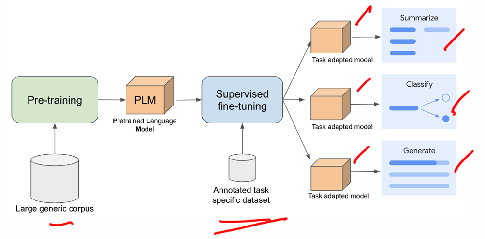
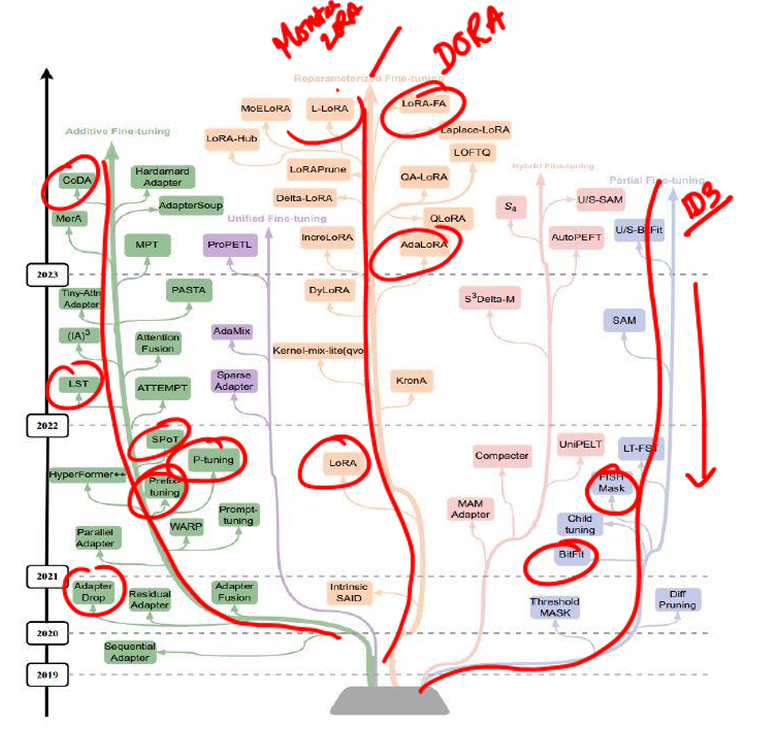
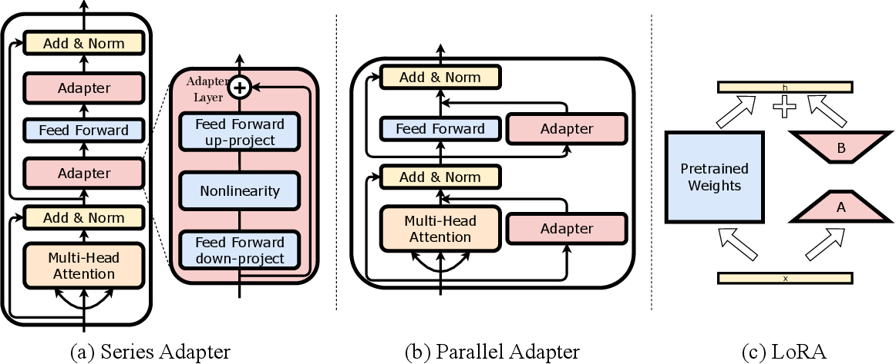
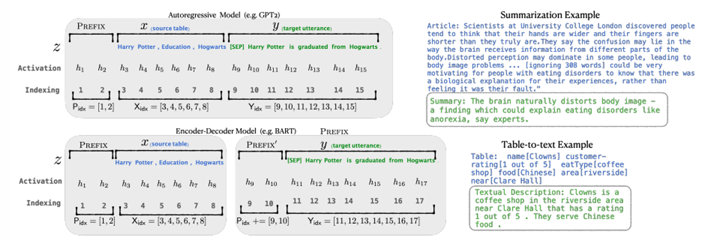

# L17 : Model Compression - PEFT

Why big models like GPT-3/GPT-4 etc. are't good for our environments ?

1. Power Consumption
2. GPU Compute Consumption
3. Water Consumption

Thus, It divide the society between rich have access to such high GPU compute machine to run the model but not poor.

Can we make llms less hungry for resource and thirsty for water ?

Yes, Then How we can achieve above ?

LLM Efficiency -

1. Better speedup during inference time.
2. Parameter size of model
3. Training process : PEFT - Adaptive, Selective and Re-parameterization.

Note - These training process(PEFT) don't alter the whole parameters of the model but they do select specific parameters and tweek them accordingly for specific tasks. We even drop less importent parameters and update the specific parameters of the model that are importent during training(PEFT).

Why Fine-Tuning LLMs ?

1. Transformers trained onto large general corpus of data -> Pre-training -> Foundation Models
2. Tasks -> How to adapt these models for domain/specific tasks because they are generalized during pre-training ?
3. Post-training-> SFT(Full Fine-tuning) -> Update all model parameters using task
   specific data.

What are the challenges in Full fine-tuning of LLM ?

1. Post-training will require alots of domain specific datasets and will be time consuming.
2. Memory and computation
   - tweeking billions of parameters of model, gpu memory will be the bottle neck.
   - training expensive and require to have a full copy of model for every task.
3. Deployment : we can't switch between tasks

How can we deal with such challenges or avoide the above process to achieve same goal ?
**Idea : Modular Approach**

1. Select the module and data for specific task
2. Post-train only these module onto the data
3. We only transfer the module of the model

**Idea : In-Context Learning**

1. Feed input-target example(few shot learning)
2. Advantage - No-training required, Fast and Flexible because no parameter updates to the model
3. Disadvantage - Prompts(number of tokens large), Don't generalize it and No-learning at all.

What is Parameter Efficient Training(PEFT) ?

1. A set of strategies to adapt large pre-trained models by training only a small subset of parameters.
2. Post-training Idea : Core model remains frozen and auxiliary or selective parameters are updated.

Why PEFT ?

1. Reduce compute and memory footprint
2. Allow reusability and modular adaptation
3. Each module can enable personalization and domain-specific training on edge devices

What are different Types of PEFT ?

1. **Additive PEFT** : We add new small size module(parameter) to the model. Ex-Adapters, Pre-fix and Prompts tuning.
2. **Selective PEFT** : selectivly updating a subset of parameters of the models.
3. **Re-Parameterization PEFT** : Re-express the parameters matrix differently t enable efficient finetuning
   

### Additive PEFT

What is Additive PEFT ?

We have pre-trained model architectures and its parameters. The core idea is the insert an adaptive layers in between the transformer layers and during post-training only adapters parameters will update and core parameters of models will remains frozen.

What are the advantages of the Additive PEFT ?

1. We can add and plug in task specific adapters
2. We addup a small memory for every task specific adapters

What are the disadvantages of Additive PEFT ?

1. Duo to addition of paramers inference time increase.
2. Adapter addition into the architecture, needed to alter the model architecture.

Where to add the adapter layers ?

#### 1. Prefix-Tuning

What is prefix tuning ?

We learn task specific key/value vectors that are pre-apended to each layers of self attention. During back propagation only pre-appended parts weights will be updated but they affects the key and values also.

Method :

Learnable vector P is called Soft Prompt
 input X of length n
 prefix P of length m
 modified input X’ = [P; X]
 shape of X’ = (n+m) x d
 where d is model’s hidden size

During fine-tuning, the parameters of P are optimised for the specific task
 Prefix vectors are added to key and value but omitted from the query vector
Note - Addition of prefix to every layers

#### 2. Prompt-Tuning

What is Prompt Tuning ?

### Selective Methods

What is Selective PEFT ?

### Re-Parameterization Methods

What is Re-Parameterization ?
