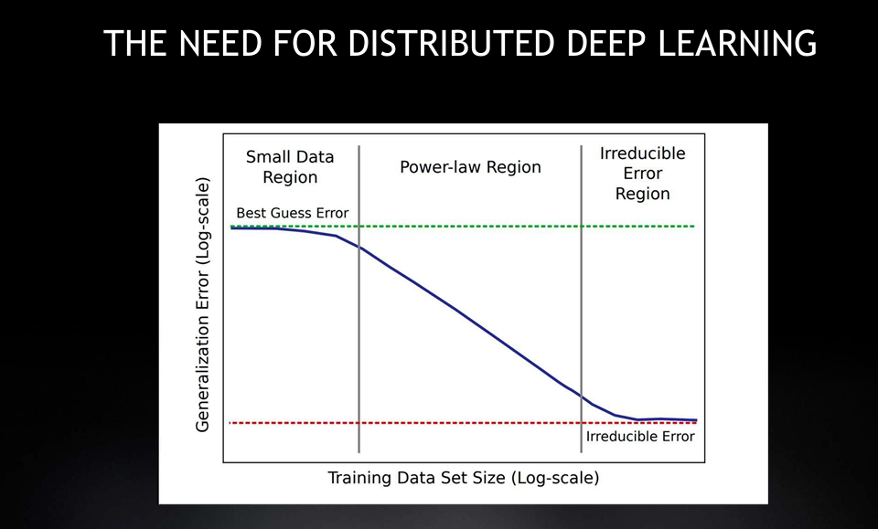
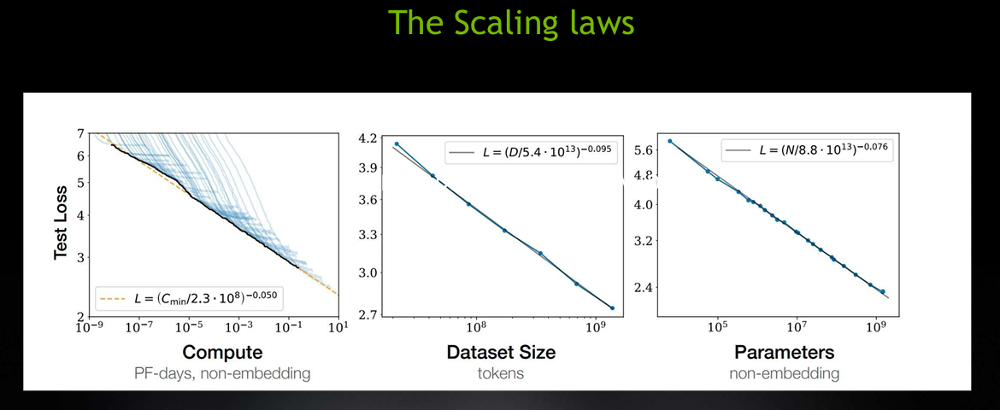
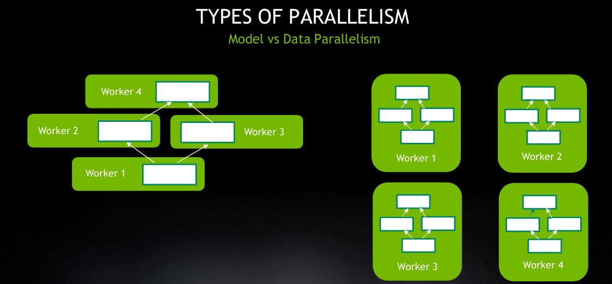
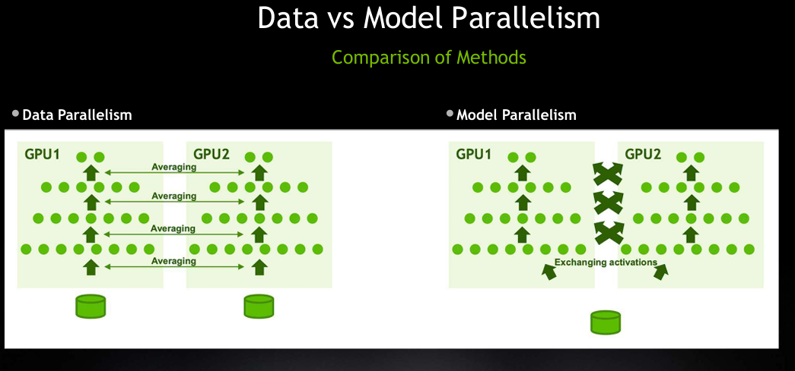
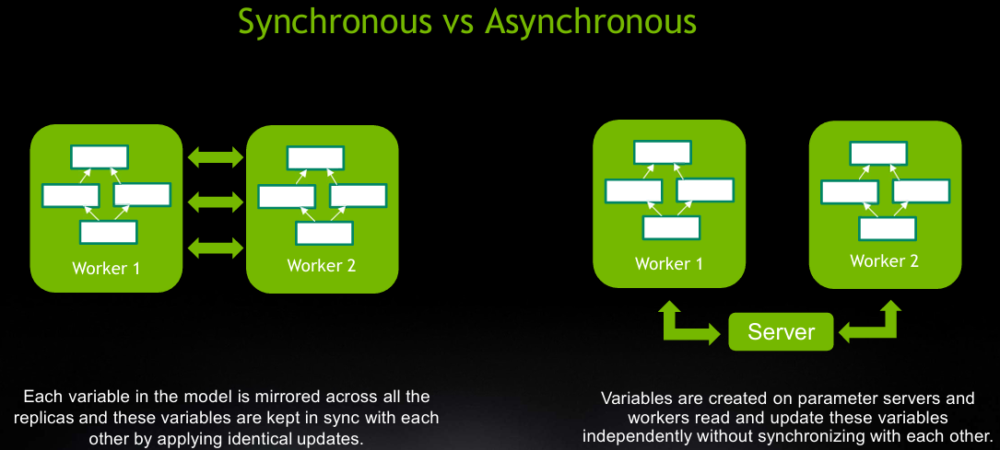

<h1 align="center"> Fundamentals of Distributed AI Computing </h1>

#### Introduction : The Need for Distributed Computing

Why do we need distributed computing for AI ?

During leaning the deep learning frameworks like PyTorch and TensorFlow, we have seen that how they actually use the single GPU machine for accelerated computation. The current Modern AI advancement came to a point, where single GPU machine is no longer remains sufficient due to computation hungry state of art large models.

Now, the state-of-the-art AI work requires another level of parallelism i.e distributing the workload beyond just the thousands of cores within one GPU means distribution of workload onto multiple GPUs.

#### Motivation : The AI Revolution and Growing Model Size

We have seen the AI Revolution in past decade(2010-2020) but it has come up with a massive growth in size of deep learning networks workloads which demands a huge amount of computational power.

The scaling states that as model parameters grows, the more and more compute (measured in FLOPs - Floating Point Operations Per Second) required to train them

1. **2015 (Microsoft ResNet):** 16 million parameters
2. **2016 (Baidu Deep Speech):** 300 million parameters, requiring compute in the range of 20 exaflops
3. **2017 (Google Neural Machine Translation):** Parameters reached the scale of *billions*

The exponential increase in model size and data directly motivates the need for multi-GPU programming

#### The Key Relationship : Data Set Size vs Model Accuracy

The Researcher has empirically validated a key relationship:

* **As the training dataset size increases, the model's accuracy also increases**.
* The relationship appears to be **linear in a logarithmic space**.
* The trend holds true across a wide variety of models and problem types, including image classification, language models, and speech recognition.
* We are currently in a "power law region" where the generalization error of a model consistently reduces as the training dataset size increases.

However, this increase in data and model parameters also leads to a linear increase in the compute requirements needed to train these models to convergence. The gap between the compute required and what a single GPU can provide is what distributed deep learning aims to solve.

#### The Benefits of Multi-GPU Training

When we use multiple GPUs for training deep learning models, provides two major advantages.

1. **Get the Same Results, Faster** : To solve the same problem in a fraction of the time that allows for faster iteration, experimentation and debugging.
2. **Get Better Results, in the Same Time** : Given a fixed training window (e.g., two days), we can train on more data, run more iterations, or, most importantly, train a much larger and more complex model.

One of the real world events from the work life of a data scientist's is that researcher spends most of their time to just waiting for model to train.

Model Training Performance of certain tasks like

1. ResNet-50 model training for task of Image Classification on one A100 GPU takes approx 14 hours and 8 A100 GPUs takes only 3 hours.
2. BERT model pretraining for task of Language Modeling on 8V100 GPUs takes 153 hours and 1024 V100 GPUs only 1 hour.

Hence we reduce the time it takes to get the results by using just more GPUs.

#### Overview of Multi-GPU Training Methods

There are mainly two most commonly used methods for distributed training of the deep learning models

1. Data Parallelism
2. Model Parallelism
3. Hybrid Parallelism

**Data Parallelism** : It is the most common and easy approach for multi-GPU model training. The core idea is to spread the *input data* (e.g., a large batch of images) across the different GPUs(workers).

How Data Parallelism model training works ?

1. We make copy of the entire model and replicate on each worker(GPU).
2. We divide dataset into chunks, and each GPU trains the *same* model on its *different* chunk of data.
3. Then during training, each GPU independently calculates the gradients (weight changes) based on its data.
4. All GPUs then **exchange and average their gradients** to update the model weights, ensuring all model copies stay in sync.

Limitation : Speeding up training only when the model fits on a single GPU but have a large amount of data.

**Model Parallelism** : It is more complex that the data parallelism and used when the model itself too large and does't fit into the single GPU's memory. Its core ideal is to spread the model's computation across the different GPUs and all GPUs process the same data.

How model parallelism works ?

1. The model's layers are split and placed on different GPUs. For example, GPU 1 handles layers 1-10, GPU 2 handles layers 11-20, and so on
2. **Forward Propagation:** A batch of data goes to GPU 1, which performs its computation and passes the result to GPU 2, which passes its result to GPU 3, and so on, sequentially.
3. **Backward Propagation:** The process happens in reverse, starting from the last GPU and flowing backward to the first.

Limitation - It is inefficient for a simple synchronous operation, while GPU 1 is working, all other GPUs are idle and waiting for their turn. It can be overcome with more complex asynchronous operations.

**Hybrid Parallelism**  : A combination of both methods can be used. For example, you might use **model parallelism** to span a giant network across 8 GPUs on one machine (a "node"), and then use **data parallelism** to have 10 such nodes each process a different batch of data.

#### Communication in Parallelism Methods

A comparison of the communication patterns in Data Parallelism vs. Model Parallelism.

Data Parallelism : The same model (layers) exists on all GPUs, but each GPU processes different data and **Communication:** Gradients are communicated across all GPUs and then averaged.

Model Parallelism : The model itself is split, with different layers on different GPUs. **Communication:** Activations (outputs of one layer) are passed from one GPU to the next. The communication pattern is fundamentally different.

#### Synchronous vs. Asynchronous Data Parallelism

There are two primary communication strategies for data parallelism

1. **Synchronous Communication**
   - Concept : All workers(GPUs) are kept in sync.
   - Process : At each step, every worker must wait for all other workers to finish their computation before gradients are averaged and the model is updated.
   - Result : All workers have the exact same copy of the model at all times.
   - Limitation : If one worker is slow or lagging (load imbalance), it becomes a bottleneck and affects the scalability of all other workers.
2. **Asynchronous Communication**
   - Concept : Introduces a Parameter Server
   - Process : (i) Workers independently fetch the current model variables (parameters) from the server. (ii) They process their batch of data and calculate gradients. (iii) They send their updates back to the parameter server, which applies them to the central model.
   - Result : Workers operate independently and don't have to wait for each other, can lead to better scaling when there is a load imbalance.

#### The Bottleneck: Communication and System Topology

Which method should chosen (Data/Model, Sync/Async) for distributed training but one thing is common **communication.** Thus, workers must communicate, either with each other or with a parameter server. Therefore, the performance and scalability of distributed training are heavily dependent on the **System Topology.**

What is system topology ?

It refers to

1. How GPUs are connected to each other *within* a single machine (node).
2. How different machines (nodes) are connected to each other.
3. How GPUs are connected to the interconnect (the communication "highway")

What is the importance of the system topology ?

A system with a faster, lower-latency topology can offer a significant speedup (e.g., up to 2.5x) over a baseline system, even with the same GPUs.

#### Key Metrices : Latency vs. Throughput

There are two key metrices to understand the topology

1. Latency : The time it takes for a *single packet* of data to be transferred. This is like a "ping" test. Low latency is crucial for frequent, small communications, like gradient updates.
2. Throughput(Bandwidth) : The *amount* of data that can be transferred in one unit of time (e.g., gigabytes per second).

#### Understanding Interconnects (The "Highways")

Interconnects are the physical pathways that connecting components like

1. **PCIe (Peripheral Component Interconnect Express):** The standard bus connecting GPUs to the CPU
2. **NVLink:** A specialized, high-bandwidth, low-latency interconnect developed by NVIDIA for connecting GPUs directly to each other. A single modern GPU can have a total NVLink bandwidth of 600 GB/s, which is twice the previous generation

Note : Using multiple GPUs on a cloud instance that *lacks* NVLink may not provide the expected scaling because the GPUs are forced to communicate over the slower PCIe bus

#### GPU Direct .vs Host Staging

The system's topology dedicates to how data moves

1. **Host Staging(Bad)** : To move data from GPU 0 to GPU 1, the data must first travel *up* to the CPU via the PCIe bus, get staged in a buffer, and then travel *down* to GPU 1, again via PCIe. This is slow and involves the CPU.
2. **GPU Direct (Good):** With a proper topology (using NVLink or a PCIe switch), GPUs can communicate in a **peer-to-peer** manner. GPU 0 can transfer data directly to GPU 1 without involving the CPU.

How to Check Your System Topology

We can use a built-in NVIDIA command to see how your components are connected: `nvidia-smi topo -m`

It generates a matrix showing connection types betwen all GPUs and network cards

- NV (nv1) : A direct NVLink connection, which is fasterst.
- SYS : The connection must "traverse" the PCIe bus and CPU (Host Staging) and this is the slowest.
- X : The device itself

Note : A good topology will have as many direct `NV` links as possible, while a poor one will show many `SYS` connections.

What is the Impact of System Topology ?

1. Bad System (PCIe only): Both data loading (CPU to GPU) and gradient averaging (GPU to GPU) must share the same, slow PCIe bus. This creates a resource congestion, choking the bus
2. Good System (PCIe + NVLink): The system is smart.
   - Data loading happens over the PCIe bus (CPU to GPUs)
   - Gradient averaging happens over the dedicated, high-speed NVLink (GPU to GPU)
   - There is no sharing of communication resources, leading to no congestion and much better performance.

#### NCCL: The "Magic" Behind the Scenes

We don't needed to manage the communication mannually because NVIDIA provides the NVIDIA Collective Communication Library (NCCL) that manages all possible communication efficiently.

What is NCCL ?
A library that provides highly optimized, fast routines for multi-GPU and multi-node communication (like "all-reduce," "broadcast," etc.)

What NCCL does ?

1. **Topology Detection:** When initialized, NCCL scans your system to build a graph of all GPUs, CPUs, network cards, and interconnects (PCIe, NVLink, etc.)
2. **Find Optimal Path :** It runs an extensive search on this graph to find the fastest possible communication path (e.g., a "ring" or "tree") for operations like gradient averaging.
3. Executes Communication : It runs these communication routines as small, efficient kernels directly on the GPUs, minimizing CPU involvement

Note : All major deep learning frameworks (PyTorch, TensorFlow, etc.) are integrated with NCCL. When you activate multi-GPU training, they use NCCL behind the scenes to handle all the complex communication for us.

#### Conclusion

We needed distributed computing for modern AI, so we required multi-GPU communication. 

What is Multi-GPU communication ?

* The choice of **system topology** (interconnects like NVLink) is critical for performance.
* A good topology avoids **congestion** by separating data loading (on PCIe) from gradient averaging (on NVLink).
* Libraries like **NCCL** automate this entire process, detecting the best topology and executing communication efficiently.

## References

1.
