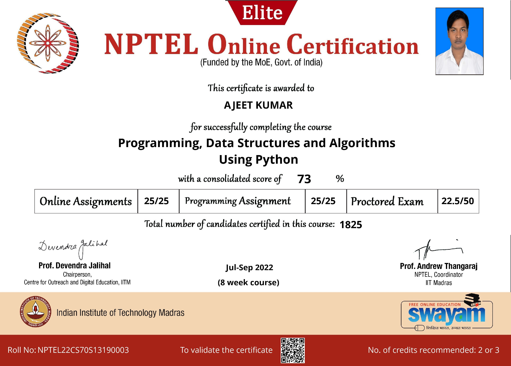
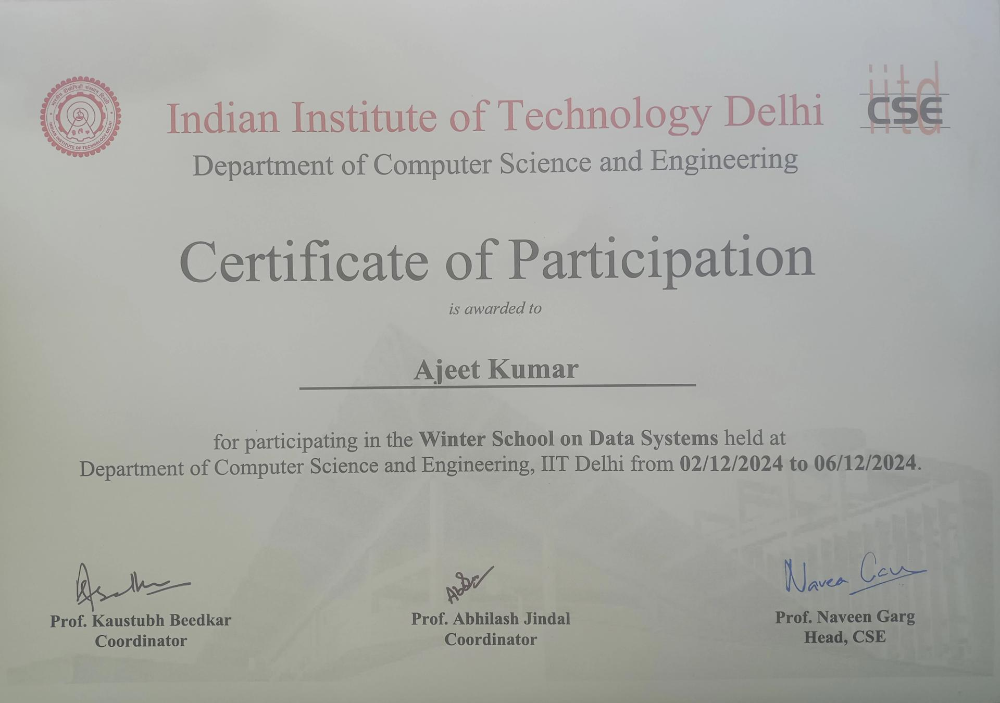
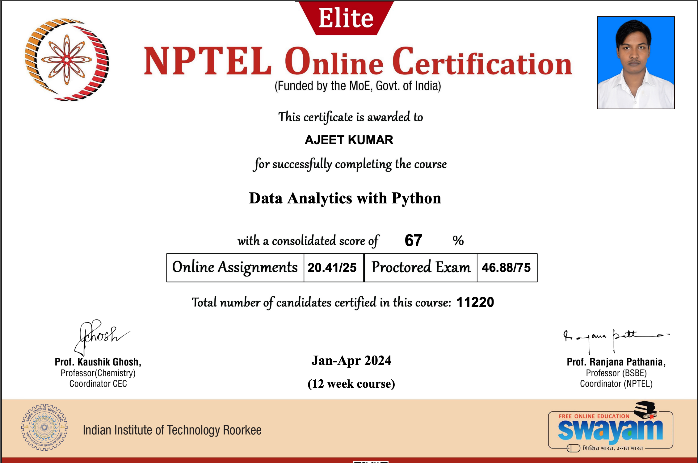
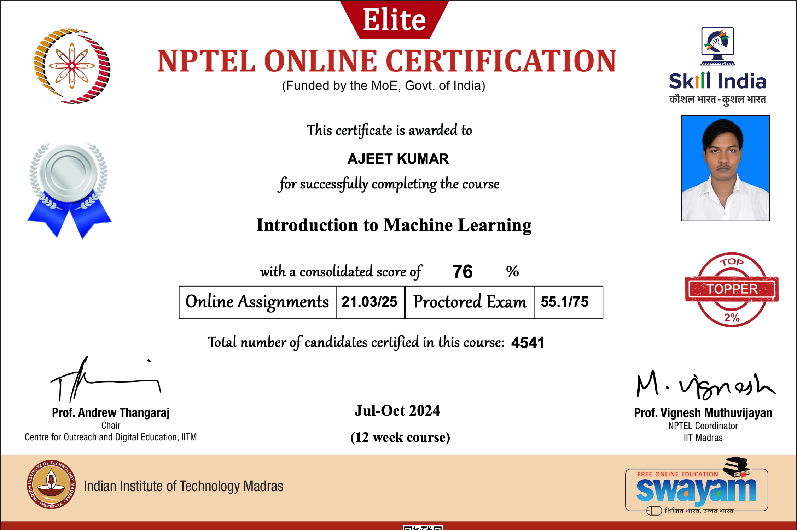
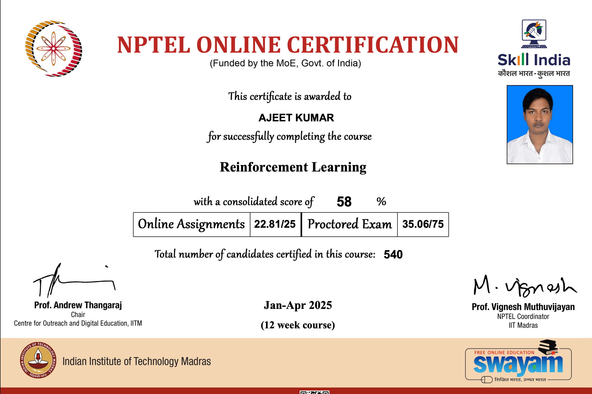
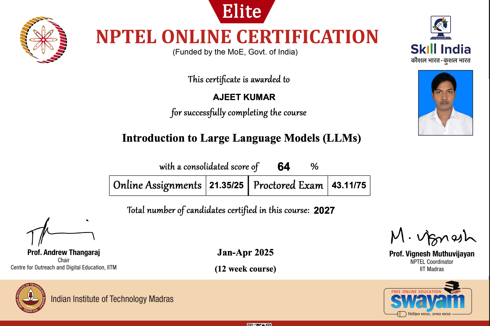
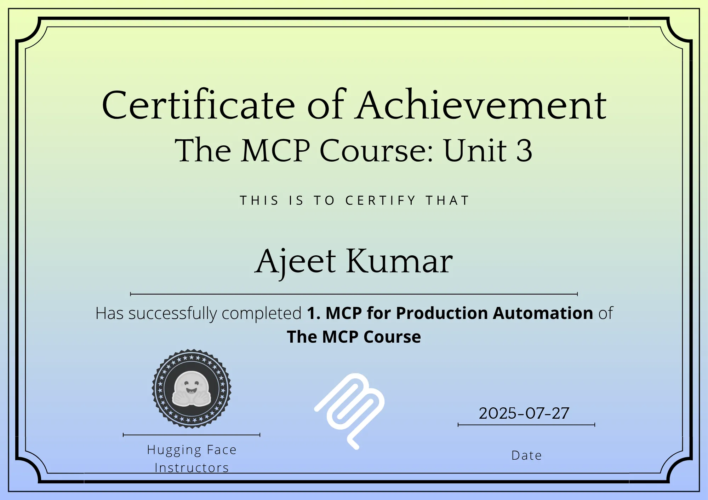

# Course-AI

The list of the courses that i have taken throughout the my journey in field of computer science, artificial intelligence and data science

## Artificial Intelligence and Data Science NPTEL Specialization

## Programming, Data Structure and Algorithms

## Data Systems : Cloud Computing, Redis, Spark, Flink and Distributed Systems

## Data Analysis and Data Science

## Machine Learning, Deep Learning and Artificial Intelligence

## Agentic Systems and Model Context Protocols

# 
